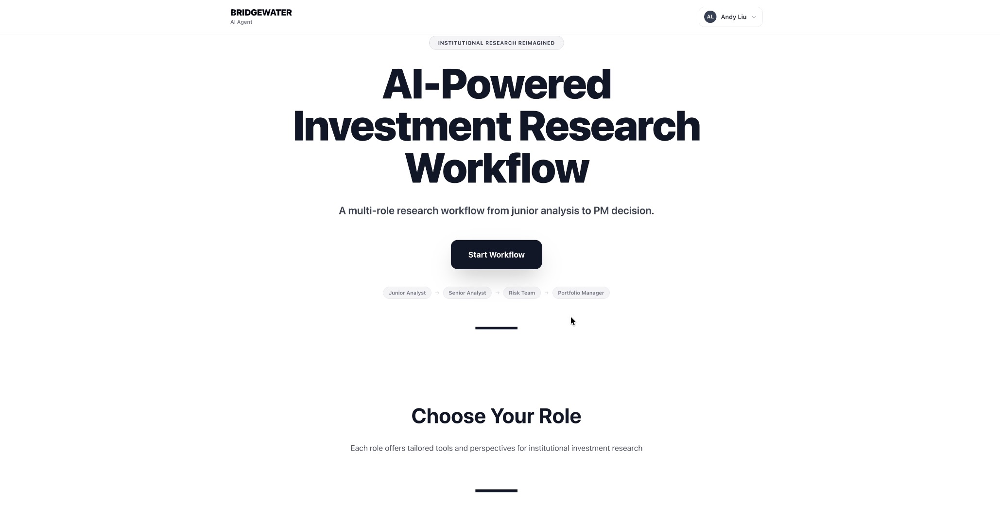

# Bridgewater AI Agent

> **Independent student course project** — UC San Diego Rady School of
> Management, MGTA 495 (Generative AI for Business), Group 16. This project is
> **not affiliated with, endorsed by, or connected to Bridgewater Associates,
> L.P.** "Bridgewater" is used descriptively, for the systematic,
> principles-based investment-research style the workflow models. See
> `ui/bridgewater-ai-agent/src/app/legal/page.jsx` for the full disclaimer.



**Provenance & notes for readers**

- Built on the MGTA 495 course starter template; the workflow design, skills,
  tools, and implementation are the project team's work.
- During the course, LLM access ran through the university's LLM gateway
  (OpenAI-compatible). Configure your own endpoint and keys via `.env` — see
  `.env.example`. This repository contains no live credentials and no school
  infrastructure addresses.
- `data/raw/` (bulk SEC / news pulls, ~21 MB) is intentionally not tracked;
  regenerate it with `scripts/collect_real_raw_data.py`. The processed demo
  data and the final recommendation packet under `artifacts/` are included.
- The ChatGPT/Codex OAuth helper (`utils/oauth_gpt.py`) reads its client id
  from the environment (`OPENAI_CODEX_CLIENT_ID`).

---

This repository is the MGTA 495R Milestone 04 final submission for a
Bridgewater-style AI-supported investment research workflow. It is a student
prototype for research process redesign, not a production trading system.

The project shows how an AI coworker can help an investment team move from a
research assignment to an evidence-backed memo, risk handoff, and Portfolio
Manager review while keeping human judgment in control.

## Business Process

The redesigned process is an equity research workflow for two demo tickers,
`NVDA` and `KO`. In the current manual process, analysts would collect SEC,
news, macro, market, valuation, and policy evidence separately, then pass
their work through Senior Analyst, Risk Team, and Portfolio Manager review.

The AI-supported process centralizes that work into a structured
`recommendation_packet.json`, exposes evidence in the UI, drafts role-specific
text from grounded packet context, and forces review gates before any local
decision is recorded.

## Roles

| Role | What the AI supports | What the human controls |
|---|---|---|
| Junior Analyst | Source collection, evidence review, indicator explanations, valuation artifacts, and a synthesis memo draft. | Research framing, evidence inspection, memo edits, and handoff readiness. |
| Senior Analyst | Valuation review, assumption challenge, proposal rationale, and risk-handoff draft text. | Final proposal stance, sizing assumptions, risk controls, and escalation to Risk Team. |
| Risk Team | Bear/base/bull scenario analysis, valuation and portfolio impact summaries, and PM handoff language. | Scenario selection, stress assumptions, risk judgment, and controls. |
| Portfolio Manager | Devil's advocate decision debate and final checklist support. | Local decision record and unresolved-question judgment. |

## AI Coworker

The AI coworker acts as a research assistant and reviewer. It can draft,
explain, summarize, challenge, and organize evidence, but it does not approve
proposals, execute trades, route orders, or override human review.

The backend is intentionally conservative. If an LLM key is missing or an LLM
call fails, the API returns deterministic packet-based fallback responses with
limitations instead of inventing unsupported analysis.

## Active Skills

Active backend skills live in `skills/` and are invoked through `POST /chat`.

| Skill | Chat mode | Purpose |
|---|---|---|
| `skills/draft-synthesis-memo` | `synthesis_memo` | Drafts role-aware, editable memo sections from the recommendation packet with source maps and human review notes. |
| `skills/explain-indicator-signal` | `indicator_explanation` | Explains why a named indicator is positive, negative, or mixed using packet evidence and limitations. |
| `skills/run-risk-scenario-analysis` | `risk_scenario_analysis` | Builds Risk Team bear/base/bull scenario analysis from Senior proposal, valuation basis, and risk settings. |
| `skills/run-pm-decision-debate` | `pm_decision_debate` | Creates a Portfolio Manager devil's advocate debate with five challenger perspectives and unresolved questions. |

## Tools, Data, And RAG

Deterministic tools in `tools/` collect and prepare raw data, transform
evidence, build stock features, score indicators, run valuation models, stress
the portfolio, and generate the final packet.

Primary data and artifacts:

- `data/raw/`: SEC metadata, market prices, FRED macro observations, and news
  payloads.
- `data/processed/`: filing evidence, news evidence, stock features, indicator
  scorecards, model predictions, three-statement models, DCF valuations, entry
  price references, and portfolio stress results.
- `artifacts/milestone04_demo/recommendation_packet.json`: frontend-ready
  packet served by the FastAPI backend.
- `rag/knowledge_base/`: internal-style policy and review documents for
  recommendation policy, evidence display, risk escalation, scenario testing,
  memo drafting, and human approval governance.
- `rag/retrieval.py`: deterministic keyword retrieval over the knowledge base.
- `mcp_servers/bridgewater_server.py`: FastMCP wrapper for local validation and
  experimentation with pipeline helpers.

## UI Map

The frontend lives in `ui/bridgewater-ai-agent/` and is built with Next.js.
The required Milestone 04 views are present across the role workflow:

| Required view | Where to find it |
|---|---|
| Start screen | `/` role selection and `/junior-analyst/step-1` research assignment intake. |
| AI work screen | Junior evidence, valuation, and synthesis steps; Senior proposal; Risk scenario analysis; PM debate. |
| Evidence screen | Junior Step 2 source collection, Junior Step 3 evidence review, Junior Step 5 evidence traceability, and backend toolkit evidence/RAG layer. |
| Review screen | Junior Step 5 mark-ready review, Senior proposal and risk handoff review, Risk Team simulation/handoff, and Portfolio Manager local decision review. |

The UI calls the backend through Next.js proxy routes under
`/api/backend/*`. The browser never calls the LLM provider directly and never
receives API keys.

## Run The Backend

Create or reuse the Python environment:

```bash
uv sync
```

Activate the local virtual environment if present:

```bash
source .venv/bin/activate
```

Run the FastAPI backend:

```bash
uvicorn api.server:app --reload --host 0.0.0.0 --port 8000
```

Useful endpoints:

- `GET /health`
- `GET /recommendation/latest`
- `GET /recommendation/latest?refresh=auto`
- `POST /recommendation/run`
- `POST /chat`

Optional LLM variables can be set locally in an uncommitted `.env` file. Use
`.env.example` as the template and do not commit local secrets:

```bash
CLASS_LLM_API_KEY=your_class_key
OPENAI_API_KEY=your_openai_compatible_key
LLM_MODEL=gpt-4o-mini
LLM_BASE_URL=https://your-compatible-endpoint.example/v1
```

## Run The Frontend

```bash
cd ui/bridgewater-ai-agent
npm install
npm run dev
```

Open `http://localhost:3000`.

For a production build check:

```bash
cd ui/bridgewater-ai-agent
npm run build
```

## Run Tests

Backend checks used for final verification:

```bash
uv run --active python -m py_compile api/server.py scripts/collect_real_raw_data.py tools/generate_recommendation_packet.py skills/draft-synthesis-memo/run.py
uv run --active python -m pytest tests/tools -q
uv run --active python -m pytest tests/rag -q
```

If you already have a working Python environment with the project dependencies
installed, the equivalent direct `python -m pytest ...` commands are also fine.

These tests cover API responses, evidence grounding, skill fallbacks,
valuation limitations, conservative recommendation behavior, RAG retrieval,
scenario analysis, PM debate behavior, and API-key safety.

## Guardrails

- No trade execution exists in the backend or frontend.
- No external order routing exists in the backend or frontend.
- PM decisions are local workflow records only.
- Human review is required for memo handoff, Senior proposal, Risk Team
  judgment, and PM decision review.
- Evidence and source paths are displayed through packet fields, citations,
  source maps, and UI evidence panels.
- Missing, weak, stale, or conflicting evidence produces limitations,
  warnings, conservative action gates, or deterministic fallback text.
- LLM output is drafting support only and cannot change backend guardrails.

## Milestone 04 Checklist

| Requirement | Status | Location |
|---|---|---|
| Final process redesign | Present | `ai_process_design.md`, this README |
| Human review/control plan | Present | `human_review_plan.md` |
| UI start/AI work/evidence/review screens | Present | `ui/bridgewater-ai-agent/` |
| Evidence/source use | Present | `evidence_and_sources.md`, `rag/`, packet source maps |
| Time/cost/quality estimates | Present | `estimates.md` |
| Face-validity check | Present | `face_validity.md` |
| Failure cases | Present | `failure_cases.md` |
| Testing results | Present | `test_report.md`, `tests/tools/`, `tests/rag/` |
| Presentation slides folder | Present | `presentation_slides/` |

## Main Submission Files

- `ai_process_design.md`
- `human_review_plan.md`
- `evidence_and_sources.md`
- `estimates.md`
- `face_validity.md`
- `failure_cases.md`
- `test_report.md`
- `presentation_slides/README.md`
- `api/`, `skills/`, `tools/`, `tests/`, `rag/`, `data/`, `artifacts/`
- `ui/bridgewater-ai-agent/`
